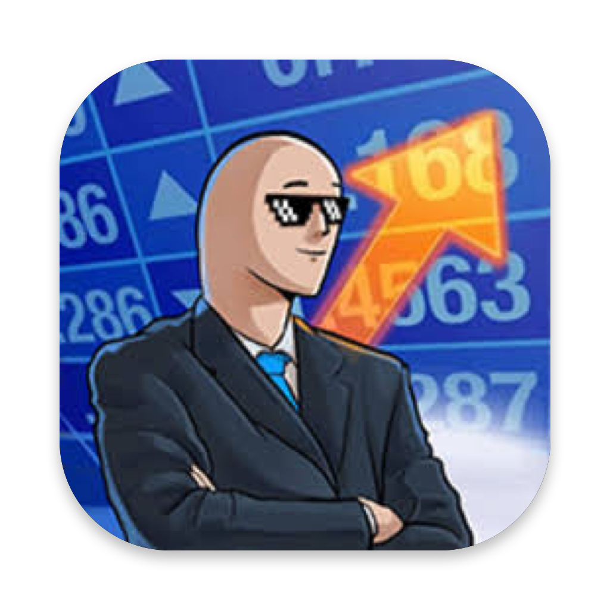

<p align="center"></p>

# StockNotch

A native macOS widget that lives in the MacBook notch and shows live stock and crypto prices, daily change and your portfolio's profit and loss. Hover the notch to expand it; move away and it tucks back in.

Built with SwiftUI and AppKit, no third-party dependencies.

## Features

- **Notch widget**: a black panel that blends with the notch, cycles through your assets (`PETR4 ▲ 1.20%`) and expands on hover into a full portfolio view. On displays without a notch it becomes a small pill centered on the menu bar.
- **Stocks and crypto**: Brazilian (B3) and US stocks via Yahoo Finance, refreshed every 10 seconds; crypto streamed live from the Binance public WebSocket, with the REST API as a fallback. Daily change uses the same definition as Google Finance in each market.
- **Data age at a glance**: each price carries a badge: *live*, the source delay (*15 min* for B3), *closed*, or a warning with the time of the last update when a price hasn't refreshed for over 2 minutes.
- **Profit and loss**: record purchases and sales and see average cost, unrealized and realized P&L per asset and a single portfolio total (value, today's change, unrealized and realized return). Uses the average-cost method.
- **Language and currency**: Brazilian Portuguese or English, and totals in BRL, USD or EUR (**Settings** in the management window). Each asset's price stays in its own currency (PETR4 in R$, AAPL in US$); position value, P&L and totals are converted with Yahoo Finance exchange rates fetched in the same refresh as the prices.
- **Binance account sync (read-only)**: connect an API key and your spot and Simple Earn Flexible balances show up automatically. Enter your average purchase price per coin (in BRL) to include them in unrealized P&L.
- **Management window**: a native table with your assets, transaction history (purchases and sales) and the Binance connection.
- **Accessibility**: changes are shown with arrows and signs, not just color, and animations respect *Reduce Motion*.

## Requirements

- macOS 15 (Sequoia) or later
- Xcode 16 or later (Swift 6)

## Build and run

```bash
git clone https://github.com/rodrigovixc/macOs-notch-ticker.git
cd macOs-notch-ticker
./build.sh
open StockNotch.app
```

`build.sh` compiles a release build, wraps it in an app bundle and signs it locally (ad-hoc). Drag the app to `/Applications` and add it under **System Settings → General → Login Items** to start it with your Mac.

To work on the code, open `Package.swift` in Xcode.

## Connecting Binance

1. On Binance, go to **Account → API Management** and create a key with **only "Enable Reading"** checked.
2. In the app, open the management window (the sliders icon in the notch) → **Binance**, and paste the API Key and Secret Key.

The app checks the key's permissions and refuses any key that can trade, transfer or withdraw. The secret is stored in the macOS Keychain, never in plain files.

## Data sources and limitations

| Market | Source | Delay | Daily change (same as Google Finance) |
|---|---|---|---|
| B3 (e.g. `PETR4`, `VALE3`) | Yahoo Finance chart (unofficial), every 10 s | 15 min, like Google (real-time B3 data is paid) | vs. the previous official close |
| US stocks (e.g. `AAPL`) | Yahoo Finance chart (unofficial), every 10 s | real time | regular session vs. the previous regular close (pre- and after-market excluded) |
| Exchange rates (USD/BRL, EUR/BRL) | Yahoo Finance chart (unofficial), every 10 s; AwesomeAPI when Yahoo fails | real time (AwesomeAPI: cached up to 5 min) | since 00:00 UTC |
| Crypto (e.g. `BTC`, `ETH`) | Binance WebSocket (`<coin>usdt@kline_1d`), REST `ticker/tradingDay` as fallback | real time | since 00:00 UTC (not the last 24 h) |

- Crypto is priced like Google's `BTC-BRL`: the coin's USDT price times the USD/BRL rate of the same moment, with the change of both since 00:00 UTC. Binance's own BRL pairs drift 0.3–0.9% from Google, so they aren't used. USDT is taken as one US dollar; it usually trades about 0.15% above it, which is most of the remaining gap to Google. With USD chosen as the currency, crypto stays at its USDT price (like Google's `BTC-USD`) and needs no exchange rate at all.
- The WebSocket reconnects with a growing wait (1 s up to 60 s) when it drops, including Binance's daily cut after 24 hours and its `serverShutdown` notice, and after 60 seconds of silence. Only a connection that stayed up delivering prices starts over at 1 s; a silent one keeps backing off. While it's down, each 10-second refresh fetches the missing coins over REST. Ticks are grouped and the screen redraws at most twice per second.
- Everything on screen comes from one snapshot built from all sources at once, with a single exchange rate. A rate that hasn't refreshed for over 2 minutes is never mixed with fresh prices: the total shows as unavailable, saying since when, and crypto shows "no exchange rate" (Binance balances stay listed). The snapshot is rebuilt every 2 seconds even when the network is slow, so badges and stale-data warnings follow the clock.
- *Live* appears only for real-time sources (US stocks, exchange rates, crypto) during market hours, when the quote's own timestamp is at most 30 seconds old; a price frozen at the source shows its time instead. *15 min* on B3 likewise needs the quote time to match the delay. Crypto converted with the AwesomeAPI rate is never shown as live, and fixed prices (BRL, USDT) have no badge. Market hours come from Yahoo's trading period, extended when trades keep coming after it ends (Yahoo still had B3 closing at 17:00 when it moved to 17:55 plus the closing auction).
- Measured against Google Finance on 3 Nov 2026 (BRT), three rounds after the B3 and NASDAQ close (18:29–18:52): PETR4 and AAPL closing prices and changes matched exactly. USD/BRL and EUR/BRL were 0.01–0.07% apart in price and up to 0.12 percentage points in daily change (AwesomeAPI, the fallback: 0.02%): Google is 1–4 min behind and uses another provider, whose 00:00 UTC rate differs slightly. BTC-BRL was 0.02–0.16% apart in price and 0–0.12 points in daily change, and BTC-USD 0.08% and 0.08 points: the app's 00:00 UTC reference is 0.13–0.16% higher (USDT above the dollar), and Google is 2–3 min behind. During the session (17:38–17:43) the same Yahoo endpoint was R$ 0.01–0.02 from Google on PETR4 (both 15 min behind) and differed on AAPL only by the moment of reading, with the same previous close. Exact parity would need Google's own data provider, which has no public API.
- The Yahoo endpoint is unofficial and may change without notice.
- P&L uses the average-cost method, in date order. A purchase adds quantity and cost; a sale removes quantity and cost at the average price (which doesn't change) and adds `(sale price − average price) × quantity` to realized P&L. A position sold down to zero starts a new average on the next purchase. Only the day of each transaction is recorded, so on the same day purchases count before sales.
- A sale can't exceed what you held on that date, nor leave a later sale without enough quantity, and dates can't be in the future. A purchase that later sales depend on can only be deleted after those sales.
- Unrealized P&L is shown apart from realized P&L. It only counts what has a cost basis: your recorded purchases and Binance balances with an average price. Binance balances without one count toward total value and today's change only. Binance sales aren't imported, so there is no realized P&L for them.
- The default language and currency follow your system language (Portuguese → BRL, anything else → English and USD). Changing the language updates the app at once; system menus follow on the next launch.
- If an exchange rate is unavailable, the notch shows a warning instead of a wrong total.
- Converted figures use the current exchange rate. Today's change in another currency doesn't include that currency's own move during the day, and purchase costs are converted at today's rate, not the rate on the purchase date. So converted P&L and today's change can differ from Google Finance; figures in the asset's own currency match.
- Crypto purchases and Binance average prices are entered in BRL. Crypto prices show in BRL, or in USD when USD is chosen. A coin without a USDT pair on Binance is priced from its BRL pair over REST every 10 seconds (not streamed); one with neither gets no price.
- In English, use a period for decimals when entering purchases (`32.50`); a comma is accepted only as a thousands separator (`1,234.50`).

## Where data is stored

- Portfolio: `~/Library/Application Support/StockNotch/carteira.json` (readable JSON, easy to back up): your assets with their purchases and sales, plus the Binance average prices. Files from earlier versions (a plain list of assets) are still read and are saved in the new format on the next change.
- Binance secret: macOS Keychain, service `io.github.rodrigovixc.stocknotch.binance`

## Tests

```bash
swift test
```

The tests cover the Binance WebSocket messages (a real captured kline and the `serverShutdown` notice), Yahoo quotes with quote time, delay and trading period (real captured responses), the data-age rules (live, delayed, closed, stale, Yahoo's wrong B3 hours, holidays), frozen quotes and fixed prices, the snapshot with a single exchange rate (crypto converted like Google's `BTC-BRL`, stale rates left out, crypto in USD without a rate), the AwesomeAPI fallback (a real captured response), Binance balances without an exchange rate, tick grouping and reconnection waits (including silent connections), average-cost P&L with sales (several purchases, partial sale, full sale and buyback, same-day purchase and sale), sale validation, reading the old `carteira.json` format, realized P&L in totals, currency conversion and the single converted total (including Binance balances and missing exchange rates), symbol normalization, decimal parsing in both languages (`1.234,56`, `0.5`, `1,234.56`), translations, currency formatting per language, settings defaults and persistence, and Binance request signing, checked against the example in the Binance documentation.

## Project structure

```
Sources/StockNotch/
├── App.swift       # app entry point, formatting helpers, shared UI pieces
├── Ajustes.swift   # language and currency settings, tr() translation helper
├── Notch.swift     # notch panel, hover tracking, collapsed/expanded views
├── Painel.swift    # management window: assets table, transactions, Binance, settings
├── Carteira.swift  # portfolio model, persistence, totals, refresh cycle
├── Cotacoes.swift  # quotes and their age, snapshot, Yahoo and Binance REST
├── TempoReal.swift # Binance WebSocket stream, tick grouping, reconnection
├── Operacoes.swift # purchases and sales, average-cost position, sale validation
└── Binance.swift   # signed read-only API calls and Keychain storage
```
