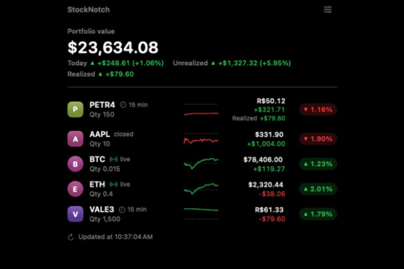
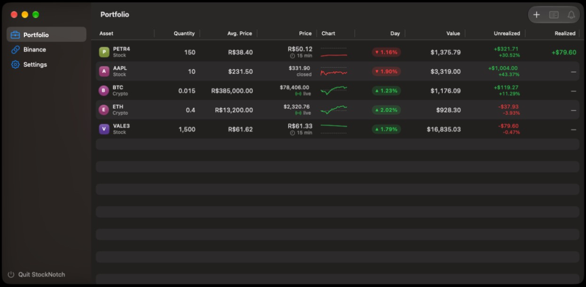

<p align="center"></p>

# StockNotch

[](https://github.com/rodrigovixc/macOs-notch-ticker/actions/workflows/ci.yml)

A native macOS widget that lives in the MacBook notch and shows stock and crypto prices, daily change and your portfolio's profit and loss. Hover the notch to expand it; move away and it tucks back in.

Built with SwiftUI and AppKit, no third-party dependencies. The interface is in Brazilian Portuguese or English.

<p align="center">
  
</p>
<p align="center">
  
</p>
<p align="center"><sub>A demo portfolio, in English with totals in US dollars.</sub></p>

## Features

- **Notch widget**: a black panel that blends with the notch, cycles through your assets (`PETR4 ▲ 1.20%`) and expands on hover into a full portfolio view. On displays without a notch it becomes a small pill centered on the menu bar.
- **Your layout**: on the **Widget** page, keep it in the notch or let it float anywhere you drag it, choose what it shows collapsed (change, price, both, or the portfolio total), how fast it switches and which assets rotate.
- **Stocks and crypto**: Brazilian (B3) and US stocks via Yahoo Finance, refreshed every 10 seconds (US stocks in real time; B3 15 minutes delayed, like Google Finance); crypto streamed live from the Binance public WebSocket, with the REST API as a fallback. Daily change uses the same definition as Google Finance in each market.
- **Intraday sparkline**: a small chart of the day next to each price, in the expanded notch and in the management table. Green or red with the day's change, with a subtle dashed line at the previous close, and it always ends at the price shown beside it.
- **Data age at a glance**: each price carries a badge: *live*, the source delay (*15 min* for B3), *closed*, the quote's time when the source can't confirm it's current, or a warning with the time of the last update when a price hasn't refreshed for over 2 minutes.
- **Profit and loss**: record purchases and sales and see average cost, unrealized and realized P&L per asset and a single portfolio total (value, today's change, unrealized and realized return). Uses the average-cost method.
- **Language and currency**: Brazilian Portuguese or English, and totals in BRL, USD or EUR (**Settings** in the management window). Each asset's price stays in its own currency (PETR4 in R$, AAPL in US$); position value, P&L and totals are converted with Yahoo Finance exchange rates fetched in the same refresh as the prices.
- **Binance account sync (read-only)**: connect an API key and your spot and Simple Earn Flexible balances show up automatically. Enter your average purchase price per coin (in BRL) to include them in unrealized P&L.
- **Price alerts**: per asset, notify when the price is above or below a value (in the asset's own currency) or when the daily change reaches ±X%. Native macOS notifications, once per crossing.
- **Privacy mode**: hides amounts and quantities (`R$ ••••`) in the notch and the management window, so you can share your screen; prices and percentages stay visible. Toggle it in **Settings** or from the notch's right-click menu.
- **Open at login**: one switch in **Settings**, using the macOS login items service.
- **Management window**: a native table with your assets, transaction history (purchases and sales), price alerts and the Binance connection.
- **CSV import**: paste or open a list of purchases and sales, check each line in a preview, then import them all at once.
- **Accessibility**: changes are shown with arrows and signs, not just color, and animations respect *Reduce Motion*.

## Requirements

- macOS 15 (Sequoia) or later
- To build from source: Xcode 16 or later (Swift 6)

## Download

Get the latest `StockNotch-<version>.zip` from [Releases](https://github.com/rodrigovixc/macOs-notch-ticker/releases/latest). The release build is for Apple Silicon.

1. Unzip it and move `StockNotch.app` to `/Applications`.
2. The app is ad-hoc signed (no Apple Developer ID), so Gatekeeper blocks the first launch: right-click the app → **Open**. If macOS only offers to move it to the Trash (macOS 15 and later), go to **System Settings → Privacy & Security** and click **Open Anyway**.

Or remove the quarantine flag in Terminal:

```bash
xattr -dr com.apple.quarantine /Applications/StockNotch.app
```

## Build and run

```bash
git clone https://github.com/rodrigovixc/macOs-notch-ticker.git
cd macOs-notch-ticker
./build.sh
open StockNotch.app
```

`build.sh` compiles a release build, wraps it in an app bundle and signs it locally (ad-hoc). Drag the app to `/Applications` and turn on **Open at login** in **Settings** to start it with your Mac. If macOS asks for approval, the app says so and has a button that opens **System Settings → General → Login Items**.

Open at login and notifications need the app bundle: when run with `swift run`, the switch is disabled and alerts don't notify.

To work on the code, open `Package.swift` in Xcode.

## Customizing the widget

The **Widget** page in the management window applies changes right away:

- **Position**: *in the notch* (top center, blending with the notch or as a pill on displays without one) or *floating*: a pill you drag anywhere, on any display. It remembers where you left it, stays on screen when it expands near an edge, and **Move Back to the Top of the Screen** resets it.
- **Collapsed**: the asset and its daily change (`PETR4 ▲ 1.20%`), the asset and its price, the asset with price and change, or the portfolio total and today's change without rotating. Wider choices make the collapsed widget wider.
- **Ticker**: switch every 2, 4, 6 or 10 seconds, and pick which assets rotate. The choice is stored as the assets you turned off, so a new asset rotates until you turn it off.

## Importing transactions

**Import…** in the Portfolio toolbar takes a CSV, pasted or opened from a file, one transaction per line:

```
type,symbol,crypto,quantity,price,date
buy,PETR4,no,200,38.40,2026-03-10
sell,PETR4,no,50,47.10,2026-09-02
buy,BTC,yes,0.015,385000,2026-06-01
```

- Type is `buy`/`sell` (or `compra`/`venda`), crypto is `yes`/`no` (or `sim`/`nao`). Prices use the same currencies as the purchase form: reais for B3 and crypto, dollars for US stocks.
- Numbers use a decimal point and no thousands separator, and dates are year-month-day, whatever the app's language, so `1.500` is never ambiguous. Columns can be separated by commas or semicolons; blank lines, `#` comments and a header line are skipped.
- Every line is checked before anything is saved, in file order, with the same rules as the form (no future dates, no sale above the holding on that date). The preview shows each transaction with its total, or why the line was refused. **Import** stays off while any line has an error, so a fixed file can be imported again without duplicating lines that were already in.
- To import from a screenshot of your broker's app, ask an AI assistant to turn the image into this format, then paste the result. A portfolio screen usually shows positions, not history: enter each one as a single purchase at its average price. Value and unrealized P&L come out right; past realized gains don't, since they aren't in the picture.

## Connecting Binance

1. On Binance, go to **Account → API Management** and create a key with **only "Enable Reading"** checked.
2. In the app, open the management window (the sliders icon in the notch) → **Binance**, and paste the API Key and Secret Key.

The app checks the key's permissions and refuses any key that can trade, transfer or withdraw, including permissions it doesn't know yet: only reading is allowed. The secret is stored in the macOS Keychain, never in plain files.

## Data sources and limitations

| Market | Source | Delay | Daily change (same as Google Finance) |
|---|---|---|---|
| B3 (e.g. `PETR4`, `VALE3`) | Yahoo Finance chart (unofficial), every 10 s | 15 min, like Google (real-time B3 data is paid): the badge says *15 min*, never *live* | vs. the previous official close |
| US stocks (e.g. `AAPL`) | Yahoo Finance chart (unofficial), every 10 s | real time | regular session vs. the previous regular close (pre- and after-market excluded) |
| Other Yahoo symbols (other exchanges) | Yahoo Finance chart (unofficial), every 10 s | unknown: the badge shows the quote's time, never *live* | vs. Yahoo's previous close (not checked against Google) |
| Exchange rates (USD/BRL, EUR/BRL) | Yahoo Finance chart (unofficial), every 10 s; AwesomeAPI when Yahoo fails | real time (AwesomeAPI: cached up to 5 min) | since 00:00 UTC |
| Crypto (e.g. `BTC`, `ETH`) | Binance WebSocket (`<coin>usdt@kline_1d`), REST `ticker/tradingDay` as fallback; a coin without a USDT pair uses its BRL pair over REST every 10 s | real time | since 00:00 UTC (not the last 24 h) |
| Intraday chart | Yahoo Finance chart with 5-minute bars (stocks, USD/BRL); Binance 15-minute klines since 00:00 UTC (crypto), every 60 s | as the quote | — |

- Crypto is priced like Google's `BTC-BRL`: the coin's USDT price times the USD/BRL rate of the same moment, with the change of both since 00:00 UTC. Binance's own BRL pairs drift 0.3–0.9% from Google, so they aren't used. USDT is taken as one US dollar; it usually trades about 0.15% above it, which is most of the remaining gap to Google. With USD chosen as the currency, crypto stays at its USDT price (like Google's `BTC-USD`) and needs no exchange rate at all.
- The WebSocket reconnects with a growing wait (1 s up to 60 s) when it drops, including Binance's daily cut after 24 hours and its `serverShutdown` notice, and after 60 seconds of silence. Only a connection that stayed up delivering prices starts over at 1 s; a silent one keeps backing off. While it's down, each 10-second refresh fetches the missing coins over REST. Ticks are grouped and the screen redraws at most twice per second.
- Everything on screen comes from one snapshot built from all sources at once, with a single exchange rate. A rate that hasn't refreshed for over 2 minutes is never mixed with fresh prices: the total shows as unavailable, saying since when, and crypto shows "no exchange rate" (Binance balances stay listed). The snapshot is rebuilt every 2 seconds even when the network is slow, so badges and stale-data warnings follow the clock.
- *Live* appears only for real-time sources (US stocks, exchange rates, crypto) during market hours, when the quote's own timestamp is at most 30 seconds old; a price frozen at the source shows its time instead. *15 min* on B3 likewise needs the quote time to match the delay. Crypto in BRL carries the time of the older of its two parts, so a dollar rate frozen at the source (or the AwesomeAPI cache, or a weekend) shows the rate's time instead of *live*; fixed prices (BRL, USDT) have no badge. Market hours come from Yahoo's trading period, extended when trades keep coming after it ends (Yahoo still had B3 closing at 17:00 when it moved to 17:55 plus the closing auction).
- Measured against Google Finance on 3 Nov 2026 (BRT), three rounds after the B3 and NASDAQ close (18:29–18:52): PETR4 and AAPL closing prices and changes matched exactly. USD/BRL and EUR/BRL were 0.01–0.07% apart in price and up to 0.12 percentage points in daily change (AwesomeAPI, the fallback: 0.02%): Google is 1–4 min behind and uses another provider, whose 00:00 UTC rate differs slightly. BTC-BRL was 0.02–0.16% apart in price and 0–0.12 points in daily change, and BTC-USD 0.08% and 0.08 points: the app's 00:00 UTC reference is 0.13–0.16% higher (USDT above the dollar), and Google is 2–3 min behind. During the session (17:38–17:43) the same Yahoo endpoint was R$ 0.01–0.02 from Google on PETR4 (both 15 min behind) and differed on AAPL only by the moment of reading, with the same previous close. Exact parity would need Google's own data provider, which has no public API.
- The Yahoo endpoint is unofficial and may change without notice.
- The intraday chart is fetched every 60 seconds, less often than prices, and only for what is on screen (Binance dust isn't). A newly added asset doesn't wait for the next round: it's fetched on its own, without repeating the others. The chart covers the same day as the daily change: the trading session for stocks (the last one before the market opens), since 00:00 UTC for crypto. Its last point is always the quote shown next to it: newer points are dropped and the current price is appended, so a chart that's up to a minute behind never disagrees with the price. The dashed line is the price the daily change is measured against (previous close; 00:00 UTC for crypto), taken from the quote itself, so the line's color always matches the change. Crypto in BRL uses its USDT klines times the USD/BRL rate of each moment (Yahoo 5-minute bars), like the price; a coin priced from its BRL pair uses that pair's klines. Fixed prices (BRL, USDT) have no chart. The chart is hidden from VoiceOver (the row already reads out price and change) and, with *Reduce Motion*, appears without the drawing animation.
- P&L uses the average-cost method, in date order. A purchase adds quantity and cost; a sale removes quantity and cost at the average price (which doesn't change) and adds `(sale price − average price) × quantity` to realized P&L. A position sold down to zero starts a new average on the next purchase. Only the day of each transaction is recorded, so on the same day purchases count before sales.
- A sale can't exceed what you held on that date, nor leave a later sale without enough quantity, and dates can't be in the future. A purchase that later sales depend on can only be deleted after those sales.
- Unrealized P&L is shown apart from realized P&L. It only counts what has a cost basis: your recorded purchases and Binance balances with an average price. Binance balances without one count toward total value and today's change only. Binance sales aren't imported, so there is no realized P&L for them.
- The default language and currency follow your system language (Portuguese → BRL, anything else → English and USD). Changing the language updates the app at once; system menus follow on the next launch.
- If an exchange rate is unavailable, the notch and the Portfolio window show a warning naming the missing rate instead of a wrong total; meanwhile each row shows its value and P&L in the asset's own currency. Only USD and EUR rates are fetched: an asset quoted in any other currency (`GBp`, `CAD`, `JPY`…) keeps the total unavailable for as long as it's in the portfolio.
- Converted figures use the current exchange rate. Today's change in another currency doesn't include that currency's own move during the day, and purchase costs are converted at today's rate, not the rate on the purchase date. So converted P&L and today's change can differ from Google Finance; figures in the asset's own currency match.
- Crypto purchases and Binance average prices are entered in BRL. Crypto prices show in BRL, or in USD when USD is chosen. A coin without a USDT pair on Binance is priced from its BRL pair over REST every 10 seconds (not streamed); one with neither gets no price: it stays listed as "no quote", and the notch warns that the total leaves it out.
- In English, use a period for decimals when entering purchases (`32.50`); a comma is accepted only as a thousands separator (`1,234.50`). In Portuguese, a period before groups of exactly three digits is a thousands separator (`350.000` is 350,000; `0.5` and `12.50` are decimals). Anything that doesn't fit the language's format (`0,050` in English, `1,234.56` in Portuguese) is refused rather than guessed.

### Price alerts

- Open them from an asset's right-click menu (**Price Alerts…**) or the bell button in the toolbar. They exist for assets in the portfolio table; to set one on a coin that only comes from Binance, add it to the portfolio (without a purchase, it's just followed).
- *Above* and *below* compare the price in the currency shown when the alert was created (PETR4 in R$, AAPL in US$, crypto in R$, or in US$ with dollars chosen). Changing the display currency later doesn't change an alert's target. *Daily change* fires when the day's change reaches the percentage up or down, with the same daily change the app shows.
- Alerts are checked every time prices refresh (every 10 s for stocks, as they stream for crypto) while the app is running. Each one notifies once when the price crosses the value and re-arms only after the price moves back to the other side by at least 0.1% (0.1 points for daily change), so a price hovering on the target doesn't flood you with notifications. *Daily change* also re-arms when a new trading day starts (a new UTC day for crypto), so a second day past the threshold notifies again. An alert created when the price is already past the value notifies right away; **Add Alert** waits for the asset's first quote, which sets the alert's currency. Whether it already fired is saved, so reopening the app doesn't repeat it.
- macOS asks for notification permission when you create the first alert, not at launch. If notifications are turned off, the alerts window says so and opens System Settings.

## Where data is stored

- Portfolio: `~/Library/Application Support/StockNotch/carteira.json` (readable JSON, easy to back up): your assets with their purchases, sales and price alerts, plus the Binance average prices. Files from earlier versions (a plain list of assets, or assets without alerts) are still read and are saved in the new format on the next change. If the file exists but can't be read (invalid JSON, no `ativos` list, no permission, a folder or broken link in its place) or can't be saved, the app never writes over it: the Portfolio window says why, offers **Show in Finder**, and disables adding until it's fixed.
- Settings (language, currency, privacy mode, widget position, style and ticker): the app's macOS user defaults. Open at login is kept by macOS itself.
- Binance secret: macOS Keychain, service `io.github.rodrigovixc.stocknotch.binance`

## Tests

```bash
swift test
```

[CI](.github/workflows/ci.yml) builds and runs them on every push and pull request (macOS 26, latest stable Xcode). Pushing a `v*` tag publishes the zipped app to [Releases](https://github.com/rodrigovixc/macOs-notch-ticker/releases).

The tests cover the intraday chart (Yahoo 5-minute bars and Binance klines from real captured responses, empty bars, the last point matching the price shown, series from another day or ahead of the quote, crypto converted to BRL point by point, fixed prices), price alert crossings (fires once, re-arms only past the margin, daily change both ways, already past on creation), the quote each alert is checked against (its own currency, not the display one), alerts saved in `carteira.json` (and files without them), privacy-mode masking and its setting, the Binance WebSocket messages (a real captured kline and the `serverShutdown` notice), Yahoo quotes with quote time, delay and trading period (real captured responses), the data-age rules (live, delayed, closed, stale, Yahoo's wrong B3 hours, holidays), frozen quotes and fixed prices, the snapshot with a single exchange rate (crypto converted like Google's `BTC-BRL`, stale rates left out, crypto in USD without a rate), the AwesomeAPI fallback (a real captured response), Binance balances without an exchange rate, tick grouping and reconnection waits (including silent connections), average-cost P&L with sales (several purchases, partial sale, full sale and buyback, same-day purchase and sale), sale validation, reading the old `carteira.json` format, realized P&L in totals, currency conversion and the single converted total (including Binance balances and missing exchange rates), symbol normalization, decimal parsing in both languages (`1.234,56`, `0.5`, `1,234.56`), translations, currency formatting per language, settings defaults and persistence, Binance request signing, checked against the example in the Binance documentation, and the read-only key check (an `apiRestrictions` response with a permission the app doesn't list is refused). They also cover reading `carteira.json` from disk (missing file vs. a folder or broken link), thousands separators and invalid numbers (`350.000`, `0,050`, `inf`), daily-change alerts re-arming on a new day, crypto in BRL timed by its older part, Yahoo's wrong B3 hours right after 17:00, Binance balances without a quote, Yahoo's empty bars before the first trade of the day, and CSV import (header, comments, semicolons, a sale after its purchase in the same file, and refused lines: decimal commas, exponents, zero, future or impossible dates, unknown types, missing columns, sales above the holding).

## Project structure

```
Sources/StockNotch/
├── App.swift       # app entry point, formatting helpers, shared UI pieces
├── Ajustes.swift   # language, currency, privacy and widget settings, tr() translation helper
├── Notch.swift     # notch or floating panel, hover tracking, dragging, collapsed/expanded views
├── Painel.swift    # management window: assets table, transactions, alerts, Binance, settings
├── Carteira.swift  # portfolio model, persistence, totals, refresh cycle
├── Cotacoes.swift  # quotes and their age, snapshot, Yahoo and Binance REST
├── TempoReal.swift # Binance WebSocket stream, tick grouping, reconnection
├── Operacoes.swift # purchases and sales, average-cost position, sale validation
├── Importar.swift  # CSV import: parsing and line-by-line validation
├── Alertas.swift   # price alerts: crossing rule and native notifications
├── Grafico.swift   # intraday sparkline: series, fitting to the price shown, Swift Charts view
└── Binance.swift   # signed read-only API calls and Keychain storage
```

## License

MIT. See [LICENSE](LICENSE).
